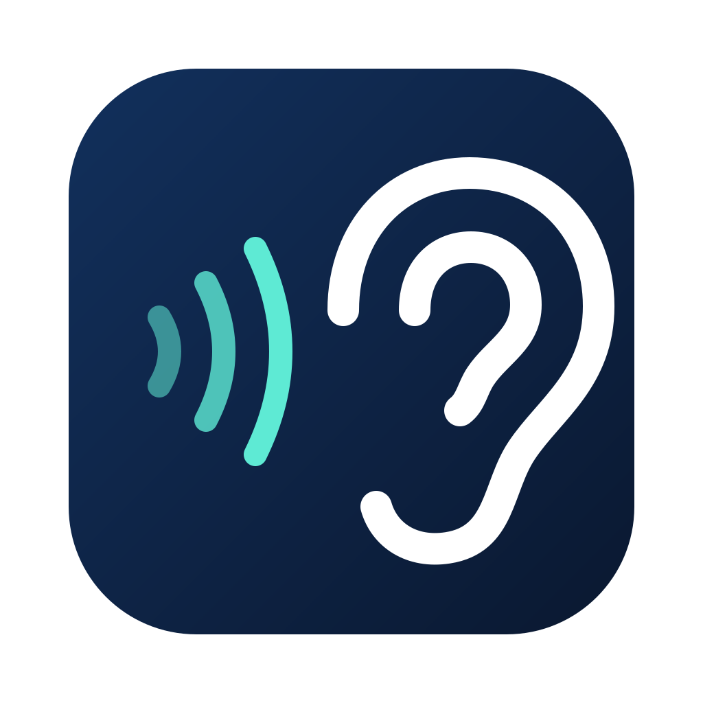
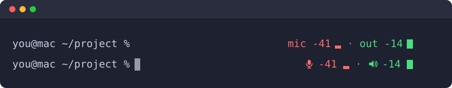
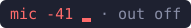

<p align="center">
  
</p>

<h1 align="center">Sevi</h1>

<p align="center">Sound levels in your terminal prompt, for zsh on macOS.</p>

<p align="center">
  
</p>

Sevi adds two live readings to the right edge of your zsh prompt:

- **mic** is how loud your surroundings are, measured by the default input device.
- **out** is how loud the audio your Mac is playing is.

The words are the default. With a Nerd Font you can show icons in their place,
as in the second line of the picture; see [Settings](#settings).

It is useful when you wear headphones or hearing devices and want to see at a
glance how loud the room is, or how loud you are playing something.

Values are in dBFS (decibels relative to digital full scale): 0 is the loudest
a signal can be, and more negative is quieter. The bar covers -60 to 0 dBFS, and
a full block `█` appears only at 0, which means the signal is clipping.

## Quick start

1. Install with [Homebrew](https://brew.sh):

   ```
   brew install --cask isureshsubramanian/sevi/sevi
   ```

2. Run `sevi init zsh` and add the line it prints to your `.zshrc`.
3. Open a new terminal and allow the two permission prompts.

You can also install it by hand from the
[latest release](https://github.com/isureshsubramanian/Sevi/releases/latest).

Details are under [Install](#install) and [Settings](#settings).

## What Sevi captures, and what it does not

Sevi needs the microphone and your Mac's audio output to measure them. This is
exactly what happens to that audio:

- Audio stays in memory, is reduced to level numbers, and is discarded.
- Audio is never recorded, written to disk, logged, or sent anywhere.
- Sevi makes no network connections.
- The only thing Sevi writes is one line of numbers in a private file that the
  prompt reads, for example `1 1794582555927 -41.2 -28.5 -13.8 -9.0 ok ok`.
- Its log holds start, stop and error codes only.

Sevi listens only while a terminal that uses it is open. It stops 30 seconds
after the last one closes, and `sevi stop` ends listening at once. While it is
listening, macOS shows its microphone indicator.

## Requirements

- macOS 14.2 or later, on a Mac with Apple silicon
- zsh, plain or with Oh My Zsh

## Install

### With Homebrew

1. Install the app and the `sevi` command:

   ```
   brew install --cask isureshsubramanian/sevi/sevi
   ```

   This puts `Sevi.app` in `/Applications`. The app is signed and notarised.
2. Ask Sevi for the line to add to your `.zshrc`:

   ```
   sevi init zsh
   ```

   Sevi never edits `.zshrc` itself. Add the printed `source` line after your
   theme or Oh My Zsh is loaded.
3. Open a new terminal.

`brew upgrade --cask sevi` installs a newer version. Terminals that are already
open keep the old plugin until you reopen them.

### By hand

1. Download `Sevi-<version>.zip` from the
   [Releases](https://github.com/isureshsubramanian/Sevi/releases) page, unzip
   it, and put `Sevi.app` in `/Applications` or `~/Applications`. The app is
   signed and notarised.
2. Ask Sevi for the line to add to your `.zshrc`:

   ```
   ~/Applications/Sevi.app/Contents/MacOS/sevi init zsh
   ```

   Sevi never edits `.zshrc` itself. Add the printed `source` line after your
   theme or Oh My Zsh is loaded.
3. Open a new terminal.

The first time, macOS asks twice: once for the microphone and once for system
audio. Both prompts name Sevi. If you decline the microphone, `mic` shows
`off`. If you decline system audio, `out` stays at `-120 ▁`, the same as when
nothing is playing, because macOS reports a declined system-audio permission
as silence. The other half still works either way.

Sevi has no window and no Dock icon. You never need to open the app yourself;
the prompt starts it.

## What the prompt shows

| Prompt | With icons | Meaning |
|---|---|---|
|  |  | Both levels, in dBFS. |
|  |  | The microphone is not available: permission was not granted, or there is no input device. |
|  |  | Output capture is not available. |
|  |  | No fresh reading: Sevi is not listening, or it is just starting. |

The pictures show the reading with `SEVI_COLOR=1`. Without it, the same text
appears in your prompt's own colour. The second column adds `SEVI_ICONS=1`,
which needs a Nerd Font in the terminal; the exact shape of the icons depends
on that font. Both are described under [Settings](#settings).

A prompt is drawn once and then stays as it is, so by default the reading
updates each time a new prompt appears. If your theme already uses the right
side of the prompt, Sevi adds its reading after it.

## Settings

Set these in `.zshrc`, before the `source` line.

| Setting | Effect |
|---|---|
| `export SEVI_LIVE=1` | Updates the reading once a second while the command line is empty. It never redraws while you are typing or a completion menu is open. It uses the shell's idle timer, so it stays off if you already use `TMOUT` or `TRAPALRM`. |
| `export SEVI_COLOR=1` | Shows the mic reading in red and the out reading in green, so the two are easy to tell apart. `off` and `--` are grey. The labels say the same thing, so nothing depends on colour alone. It is ignored when `NO_COLOR` is set. |
| `export SEVI_ICONS=1` | Shows a microphone icon and a speaker icon in place of the words `mic` and `out`. A channel that is off shows its crossed-out icon alone. The terminal must use a [Nerd Font](https://www.nerdfonts.com), version 3 or later; with any other font the icons appear as empty boxes. The font sets the size of the icons. |

## Commands

With Homebrew, run these as `sevi <command>`. Installed by hand, run them as
`~/Applications/Sevi.app/Contents/MacOS/sevi <command>`.

| Command | What it does |
|---|---|
| `status` | Says whether Sevi is listening, since when, and the current levels. |
| `stop` | Stops listening now. Sevi starts again when you open a new terminal. |
| `doctor` | Checks the install and the microphone permission, and says what to fix. It opens no audio. |
| `init zsh` | Prints the line for `.zshrc`. |

## Troubleshooting

- **The prompt shows `mic -- · out --`.** Press Enter once: the very first
  prompt in a new terminal can be drawn before Sevi has started. If it stays
  that way, run `sevi doctor`.
- **`out` stays at `-120 ▁` while audio is playing.** Allow Sevi for system
  audio recording in System Settings, under Privacy & Security, then run
  `sevi stop` and open a new terminal.
- **`mic` reads lower or higher than you expect.** Sevi measures whatever
  device macOS uses as the default input, which may be a webcam or headset
  rather than the built-in microphone.
- **Prompt frameworks that draw the whole prompt themselves** may not show the
  reading. Plain zsh and Oh My Zsh themes are supported.

## Uninstall

With Homebrew: remove the `source` line from `.zshrc`, close your terminals,
and run `brew uninstall --zap --cask sevi`. That also removes the permissions
macOS stored.

By hand:

1. Remove the `source` line from `.zshrc` and close your terminals.
2. Delete `Sevi.app`.
3. Remove the permissions macOS stored for it:

   ```
   tccutil reset All com.nerttiyana.sevi
   ```

## Building from source

You need Xcode and a Developer ID Application certificate. The certificate is
required even for development builds, because macOS names the permission
prompts after the signed, installed app.

```
make gate               # unit tests and prompt tests
sh Scripts/build-app.sh # builds and signs build/Sevi.app
```

The app icon is rendered from `Assets/AppIcon.svg` during the build.

## Licence

Apache License 2.0. See [LICENSE](LICENSE). Sevi uses Apple system frameworks
only and bundles no third-party code, fonts or media.
